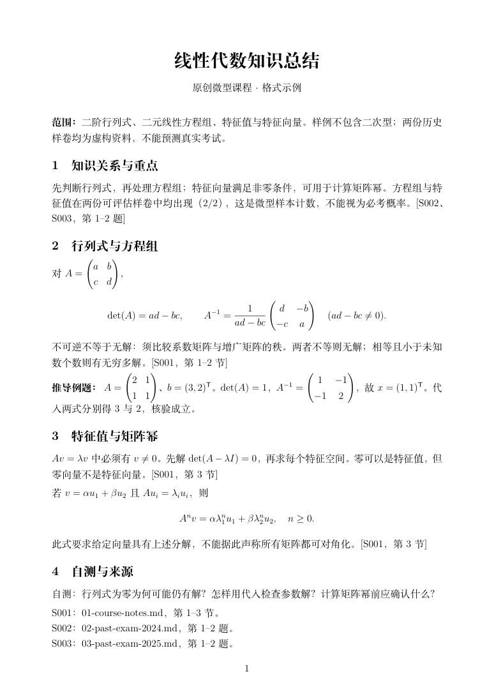
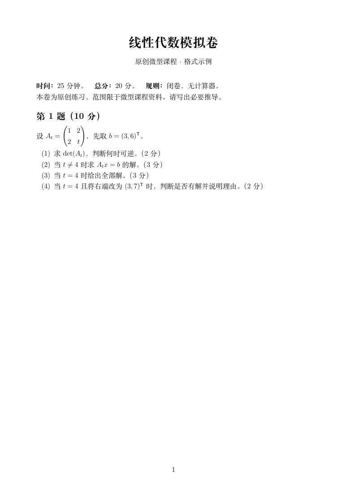
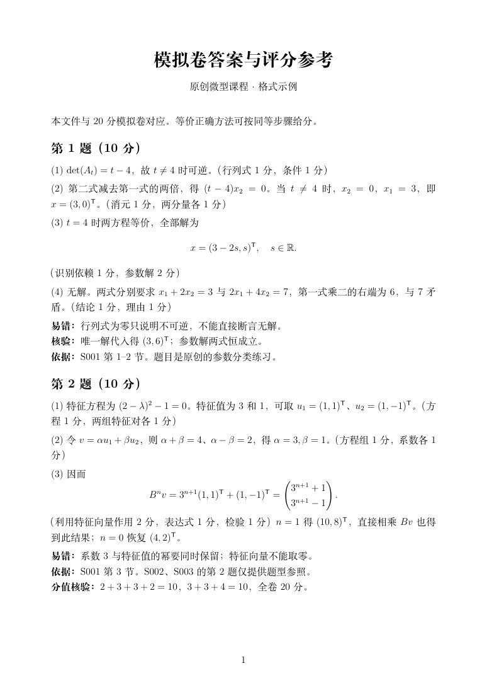

<p align="center">
  
</p>

<h1 align="center">Exam Prep · 期末复习助手</h1>

<p align="center"><strong>让一学期的资料，成为考前真正用得上的三份文档。</strong></p>
<p align="center">课程资料与往年试卷 → 知识总结 · 模拟试卷 · 答案解析</p>

<p align="center">
  <a href="https://github.com/CuiLikun/exam-prep-skill/actions/workflows/validate.yml"></a>
  <a href="LICENSE"></a>
  <a href="#quick-start"></a>
  <a href="#outputs"></a>
</p>

<p align="center">
  <a href="#outputs">看看成品</a> ·
  <a href="#quick-start">开始使用</a> ·
  <a href="#study-modes">复习模式</a> ·
  <a href="#workflow">如何工作</a> ·
  <a href="#quality">质量标准</a> ·
  <a href="#faq">常见问题</a>
</p>

---

课件散在不同文件夹，笔记夹着照片，往年卷有扫描版也有答案版。开始复习之前，你往往还得先回答：**范围是什么，重点在哪里，怎样才算会了？**

Exam Prep 为这个过程提供一套可重复执行的流程：清点资料、回查来源、梳理知识、分析真题，再把练习和讲解排成可打印的 PDF。你给出材料和目标，Codex 或 Claude Code 使用它们已有的工具完成制作。

> **适合谁？** 有课程材料、希望系统整理与自测的大学生。支持理工、编程与人文社科课程；具体解析能力取决于宿主工具。项目是 Agent Skill，不是独立运行的学习软件。

<a id="outputs"></a>

## 先看看，你会拿到什么

<table>
  <tr>
    <td width="33%" valign="top">
      <strong>01 · 知识总结</strong><br />
      <sub>建立结构，找到条件与方法。</sub><br /><br />
      <a href="examples/mini-course/preview/knowledge-summary.pdf"></a>
    </td>
    <td width="33%" valign="top">
      <strong>02 · 模拟试卷</strong><br />
      <sub>留出时间，独立完成一次检验。</sub><br /><br />
      <a href="examples/mini-course/preview/mock-exam-01.pdf"></a>
    </td>
    <td width="33%" valign="top">
      <strong>03 · 答案解析</strong><br />
      <sub>看懂过程，知道分数落在哪里。</sub><br /><br />
      <a href="examples/mini-course/preview/mock-exam-01-answers.pdf"></a>
    </td>
  </tr>
</table>

<p align="center"><sub>点击页面查看完整 PDF。以上是仓库内原创微型线性代数样例的实际渲染；封面插图为 AI 生成的概念视觉。</sub></p>

| 文档 | 为复习解决的问题 | 内容约定 |
| --- | --- | --- |
| **知识总结** | 这一章究竟要掌握什么？ | 知识关系、关键条件、解题步骤、典型错误、自测与来源 |
| **模拟试卷** | 换个问法，我还能做出来吗？ | 明确范围、题型与分值，提供新题和作答空间 |
| **答案解析** | 为什么这样做，哪里可以得分？ | 完整推导、分步评分、合理替代解法和错误诊断 |

另附资料清单、真题分析和可编辑源文件，方便检查与修改。样例用于展示结构与排版，未对所有课程、模型或文件格式完成端到端验证。

[查看原始样例材料](examples/mini-course/materials/) · [查看考点分析](examples/mini-course/preview/exam-analysis.md) · [跑一次完整示例](examples/mini-course/request.md)

<a id="quick-start"></a>

## 开始使用

**环境：** 能访问文件并执行命令的 Codex 或 Claude Code；Python 3.10+ 用于辅助脚本。生成 PDF 推荐 XeLaTeX（CTeX + Fandol 字体），也可使用环境中其他可靠的导出工具。

**1. 获取项目，安装技能**

```bash
git clone https://github.com/CuiLikun/exam-prep-skill.git
cd exam-prep-skill
python scripts/install.py --tool both
```

仅使用一个工具时，将 `both` 改为 `codex` 或 `claude`。安装器只复制技能文件；遇到同名目录会停止，保护你已有的修改。

**2. 把资料放在一个目录里**

```text
materials/线性代数/
├── 教学大纲.pdf
├── 课件/
├── 笔记/
└── 往年试卷/
```

不要求按此结构重命名。子目录、混合格式和重复副本都可以先保留。

**3. 告诉助手这次怎样复习**

```text
$exam-prep
请读取 ./materials/线性代数 里的资料和往年卷。
范围是第 1–5 章，闭卷，100 分，120 分钟。
我还有 5 天，特征值和二次型比较薄弱。

使用系统复习模式，讲解详细一些，模拟卷贴近往年难度。
生成知识总结、一套模拟卷和单独的答案解析，均为 PDF。
输出到 ./exam-prep-output/线性代数。
```

Claude Code 将第一行改为 `/exam-prep`。参数不齐时可以先省略，助手会从资料寻找依据，并注明仍需采用的假设。

<details>
<summary><strong>安装路径、旧版 Codex 与更新方式</strong></summary>

| 工具 | 默认用户目录 | 调用 |
| --- | --- | --- |
| Codex | `~/.agents/skills/exam-prep/` | `$exam-prep` |
| Claude Code | `~/.claude/skills/exam-prep/` | `/exam-prep` |

路径说明参见 [Codex 官方文档](https://learn.chatgpt.com/docs/build-skills) 与 [Claude Code 官方文档](https://code.claude.com/docs/en/skills)。若版本使用 `~/.codex/skills` 或自定义目录，可指定技能的父目录：

```bash
python scripts/install.py --tool codex --dest "~/.codex/skills"
```

项目级安装将 `--dest` 设为课程项目的 `.agents/skills` 或 `.claude/skills`；自定义目录一次仅对应一个工具。也可直接复制整个 `skills/exam-prep` 文件夹。

更新：在仓库执行 `git pull`，将已安装目录改名备份，再重新运行安装器。没有发现技能时重新打开会话。

</details>

<a id="study-modes"></a>

## 按你的复习节奏来

同一门课，补基础、考前回顾与限时练习需要不同的内容密度。直接用自然语言描述目标，或使用下表参数；它们是助手的执行偏好，不是 CLI 参数。

| 模式 | 适合此刻的你 | 总结与练习的侧重点 |
| --- | --- | --- |
| **系统复习** `balanced` | 想把课程完整串起来 | 章节依赖 → 概念与条件 → 方法与例题 → 综合自测 |
| **考前速记** `sprint` | 基础已学过，需要快速回顾 | 速查表、适用条件、容易混淆的点；保留范围缺口说明 |
| **限时自测** `practice` | 希望用一套卷检查掌握程度 | 标准题面、充足作答空间、分离的解析与错因分类 |

```yaml
STUDY_MODE: balanced          # balanced | sprint | practice
EXPLANATION_DEPTH: standard   # compact | standard | detailed
EXAM_DIFFICULTY: aligned      # aligned | foundation | challenge
MOCK_COUNT: 1
```

`aligned` 优先参考有效真题；资料不足时明确采用练习设定。`challenge` 增加推理与迁移要求，仍遵守考试范围。任何模式都保留来源、公式条件和答案核验；默认交付三类 PDF，用户也可只要求其中一类。

<details>
<summary><strong>三个可以直接套用的请求</strong></summary>

**高数 · 查缺补漏**

> 我还有一周。按大纲整理积分部分，重点解释换元与分部积分的选择依据；给出完整例题，再出一套中等难度综合卷。

**数据结构 · 限时自测**

> 根据课件和近三年试卷出两套卷。保留算法题和复杂度分析，写明输入规模与边界条件。样例能运行时请验证，答案单独保存。

**管理学 · 论述训练**

> 按教师范围整理概念辨析和案例分析。给出论点、依据、推理及评分维度，接受有依据的替代观点，避免只给一份范文。

</details>

<a id="workflow"></a>

## 从材料到成品，分六步完成

| 阶段 | 助手做什么 | 留下什么依据 |
| --- | --- | --- |
| **01 清点** | 识别文件类型、重复件与缺页 | 文件清单与读取状态 |
| **02 提取** | 按需解析、OCR 或转录，保留原始定位 | 页码、题号、幻灯片或时间戳 |
| **03 分析** | 对齐当前范围，映射知识点与独立试卷 | 考点表、统计分母、冲突与假设 |
| **04 总结** | 把知识写成可回忆、可应用的学习单元 | 概念、条件、方法、例题、自测 |
| **05 命题** | 先定蓝图，再出新题并完整求解 | 分值分配、答案、评分与核验记录 |
| **06 交付** | 排版、导出、查看页面并修正 | 三类 PDF 与编辑源文件 |

<details>
<summary><strong>输出目录与辅助脚本</strong></summary>

```text
exam-prep-output/<课程名>-<时间>/
├── knowledge-summary.pdf
├── mock-exam-01.pdf
├── mock-exam-01-answers.pdf
├── sources.json
├── exam-analysis.md
└── source/
```

清点文件（只生成清单，不读取语义）：

```bash
python skills/exam-prep/scripts/inventory.py examples/mini-course/materials --output exam-prep-output/sources.json
```

编译已编写的 TeX（需要 XeLaTeX）：

```bash
python skills/exam-prep/scripts/build_pdf.py examples/mini-course/preview/knowledge-summary.tex --output exam-prep-output/knowledge-summary.pdf
```

</details>

<a id="quality"></a>

## 一份能用的复习材料，应当经得起这些检查

| 检查 | 具体要求 |
| --- | --- |
| **回得去** | 重要结论能定位到文件与页、节或题号；外部补充单独标明 |
| **说得准** | 公式有条件，概念有边界，模糊 OCR 有待确认标记 |
| **数得清** | 同卷副本合并，残卷不当作完整样本，频次有明确分母 |
| **做得出** | 新题先完整求解；步骤分、小问分与全卷总分一致 |
| **看得懂** | 中文和公式清晰，长题分页合理，题面与答案分开 |

例如，“某考点出现在 3/4 份可评估试卷”是可回查的统计；“今年必考”不是它能够给出的结论。行列式为零时，还需要判断方程组是否相容，不能省略条件直接写成“无解”。这些要求已写进技能的执行规则。

核心规则：[SKILL.md](skills/exam-prep/SKILL.md) · [学习设计](skills/exam-prep/references/study-design.md) · [命题与核验](skills/exam-prep/references/assessment.md) · [PDF 排版](skills/exam-prep/references/pdf-delivery.md)

<a id="formats"></a>

## 你可以交给它哪些资料

| 材料 | 处理方式 | 依赖或注意事项 |
| --- | --- | --- |
| PDF、扫描卷、照片、手写笔记 | 文字提取、视觉识别或 OCR | 公式、负号、上下标和图表须核对 |
| Word、PPT、Excel | 结构解析，必要时转换副本 | 兼顾备注、嵌入图、公式和单元格 |
| Markdown、TXT、HTML、CSV、代码 | 按编码和结构读取 | 保留章节、行号与表格语义 |
| 音频、视频 | 转录并关联时间戳、画面 | 需要环境中可用的转录与视频工具 |
| 压缩包、EPUB、未知格式 | 检查、分类，选择可用解析器 | 加密、损坏或不支持时列入未读清单 |

可以接收混合格式；每种格式是否能可靠解析，取决于宿主能力。安装技能不会安装所有解析器，不可读内容也不会被当成已经掌握的材料。详见 [文件处理规则](skills/exam-prep/references/ingestion.md)。

<a id="faq"></a>

## 常见问题

<details>
<summary><strong>没有往年试卷，能用吗？</strong></summary>

可以。按大纲和课程资料设计练习，明确标为“按课程范围编制”，不会虚构历年频次或学校命题习惯。

</details>

<details>
<summary><strong>只需要一份总结，或者只需要试卷呢？</strong></summary>

直接说明交付范围。复习模式调整组织方式，用户的明确要求决定最终生成哪些文件。

</details>

<details>
<summary><strong>为什么还需要 PDF、OCR 等工具？</strong></summary>

Skill 告诉助手怎样做事，实际读取与导出仍由可用工具执行。缺少 PDF 引擎时，助手应保留源文件并明确“PDF 未生成”；不会把改后缀文件当作 PDF。若 Poppler 报 Missing language pack，需配置中文编码数据或使用其他可靠阅读器检查。

</details>

<details>
<summary><strong>我的资料会被额外上传吗？</strong></summary>

辅助脚本在本地运行。技能要求：未经授权，不额外上传到第三方 OCR 或转换服务。资料交给 Codex / Claude 本身时，仍受该产品的数据处理方式约束。实际课程资料和产物应放在被 Git 忽略的目录，分享前检查提交内容。

</details>

<details>
<summary><strong>能保证预测考题或提高多少分吗？</strong></summary>

不能。它帮助整理、练习和核验。历史频次、难度和学习建议有各自的证据边界，用户仍需核对关键内容并完成练习。

</details>

## 参与完善

欢迎带着脱敏后的真实失败案例提 [Issue](https://github.com/CuiLikun/exam-prep-skill/issues)：哪类资料读漏了、哪道题有歧义、哪个公式条件没写清，或者哪一页打印出了问题。

```bash
python -m unittest discover -s tests -v
```

测试覆盖清点、安装和 PDF 编译辅助脚本；缺少相应环境时会明确跳过 PDF 或符号链接检查，不将跳过算作已验证。

<details>
<summary><strong>项目地图</strong></summary>

```text
skills/exam-prep/       助手实际加载的技能与参考规则
scripts/install.py     Codex / Claude Code 安装器
examples/mini-course/   原创课程材料、分析、TeX 和 PDF
tests/                 辅助脚本行为测试
assets/readme/         原创封面与实际 PDF 预览
docs/visual-assets.md  插图生成提示词与视觉素材说明
```

</details>

---

文档呈现与可调参数的组织方式受到 [Taste Skill](https://github.com/Leonxlnx/taste-skill) 启发。本项目的课程复习规则、文字与封面均独立创作，与参考项目无隶属关系。[视觉素材与生成提示词](docs/visual-assets.md)。

[MIT License](LICENSE) · 代码、技能说明与原创样例适用此许可；用户提供的教材、课件和试卷不在许可范围内。
